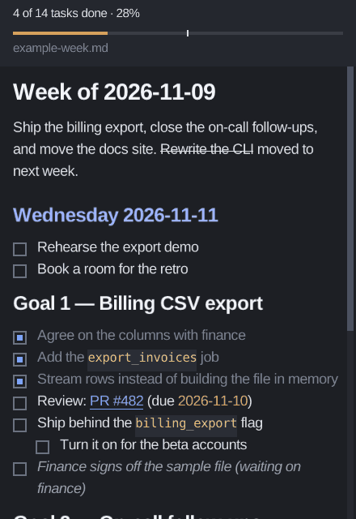

<h1 align="center">Shipinel</h1>

<p align="center">
  <i>Ship it this week.</i> A small, always-visible window that shows your
  Markdown week plan<br />and lets you tick its tasks, so the week's work stays
  in view while you do it.
</p>

<p align="center">
  <a href="https://github.com/fabiosammy/shipinel/issues">Report a bug or suggest an idea</a>
</p>

<p align="center">
  <picture>
    <source media="(prefers-reduced-motion: reduce)" srcset="docs/screenshot.png" />
    
  </picture>
</p>

## Features

- **Your plan, as you wrote it.** A Markdown file you keep in your editor (or
  that an assistant updates). Shipinel shows it and lets you tick its
  checkboxes: a click flips `[ ]` ↔ `[x]` on that exact line and saves the
  file. Edits made anywhere else show up within a second.
- **Progress against the week.** "12 of 40 tasks done · 30%", a bar filled by
  that share, and a tick where the work week is. The bar turns amber when you
  are more than a day behind, and green when everything is done.
- **Where you are.** The header names the section you are in, with its own
  count ("Goal 1 — Billing CSV export · 3 of 7"), and the plan reopens where
  you left it, at the same size, even after it was edited above you.
- **Today.** A heading about today (it holds today's date, or starts with
  today's weekday: "Monday — …", "Segunda-feira") is drawn in an accent
  color, and on a new day the plan opens there.
- **What can be done now.** A task marked as waiting (`⏳` or "(waiting on
  …)") steps back in quieter italics, so the ones you can pick up stand out;
  a date that has passed in an open task (`due 2026-11-06`) turns amber, and
  today's date turns blue like today's heading.
- **Changes noticed.** Lines edited outside Shipinel (by you in your editor,
  or an assistant) get a mark beside them for ten seconds, and a short
  notch shows where lines were deleted.
- **Keyboard**: `j`/`k`, the arrows, Page Up/Down and Home/End scroll; `+`,
  `-` and `0` zoom; `h` hides the header; `u` undoes the last tick.
- **Notifications**: a daily nudge with the number of tasks still open and
  one of them, and a warning when a tick could not be saved.
- **Tray icon**: the progress as a ring and in its tooltip, which also says
  how many open tasks are overdue or due today ("2 overdue · 1 due today");
  a click shows or hides the window, and closing can hide it there instead
  of quitting.
- **Light on the machine.** An idle window sleeps until input arrives and
  costs next to no CPU.
- Native on **Wayland** (KDE Plasma, Hyprland, GNOME) and on X11.

## Getting started

1. Install it: one executable, on x86_64 Linux with glibc 2.35 or newer
   (Ubuntu 22.04, Debian 12, Fedora 36 and later), Wayland or X11:

   ```sh
   mkdir -p ~/.local/bin
   curl -fLo ~/.local/bin/shipinel https://github.com/fabiosammy/shipinel/releases/latest/download/shipinel-linux-x86_64
   chmod +x ~/.local/bin/shipinel
   ```

   Try it on the example week:

   ```sh
   curl -fLo /tmp/example-week.md https://raw.githubusercontent.com/fabiosammy/shipinel/main/docs/example-week.md
   shipinel /tmp/example-week.md
   ```

   (`~/.local/bin` must be on your `PATH`; most desktops add it once it
   exists, after logging in again.) raylib and GLFW are inside the
   executable; the rest is on nearly every Linux desktop: libsystemd,
   libX11, an OpenGL driver, and `fc-match`, `xdg-open` and `notify-send`
   (packaging/linux/INSTALL.md lists the packages).

   **With the launcher entry and icon**: the
   [latest release](https://github.com/fabiosammy/shipinel/releases/latest)
   also has `shipinel-linux-x86_64.tar.gz`, the same executable with the
   desktop entry, the icon and an example config; follow the `INSTALL.md`
   inside ([packaging/linux/INSTALL.md](packaging/linux/INSTALL.md)).

   **With [Nix](https://nixos.org)**: `nix profile install
   github:fabiosammy/shipinel` (or a release: `…/shipinel/v0.3.1`), or
   `nix run github:fabiosammy/shipinel -- ~/notes/week.md` to run it once.
2. Point it at your plan: `shipinel ~/notes/week.md`, or set `file=` in the
   [config](#config) and run `shipinel` alone.
3. Keep it in view with a [window rule](#window-rules): position, size, on top
   and on every desktop.
4. [Start it with your session](#start-with-your-session), so the plan is
   there when you log in.
5. Optionally, turn on the [tray icon and notifications](#config).

### Keys

| Key | Does |
|---|---|
| `j` / `↓`, `k` / `↑` | Scroll a line down / up |
| Page Down / Page Up | Scroll a window down / up |
| Home / End | Go to the top / the end |
| `+` (or `=`), `-`, keypad `+` / `-` | Bigger / smaller text, with or without Ctrl; from 8 to 72 pixels |
| `0` | Back to the `--font-size` the window started with |
| `h` | Hide or show the progress header |
| `u` | Undo the last tick (once), as long as that line has not changed since |
| Tab / Shift+Tab | Move a focus ring to the next / previous checkbox (the first Tab starts at the first one in view; round the ends; the page scrolls to it) |
| Space | Tick or untick the checkbox with the focus ring, as a click would; Escape lets go of the focus |
| `?` or F1 | Open the help: every key and click with what it does (`?`, F1, Escape or a click closes it). The status line at the bottom says so |
| `g` | Open the outline: every heading with its tasks' count, the section in view selected; `j` / `k` or the arrows move, Enter or a click jumps there, `g`, Escape or a click outside closes it |
| Drag over the text, Ctrl+A | Select text (a click elsewhere clears it) |
| Ctrl+C | Copy the selected text, a line for each line on the page |
| Ctrl+F | Find: type to highlight every match (any case) and go to the first one below; Enter / Shift+Enter for the next / previous; Backspace; Escape closes it |

While the find bar is open, letters are typed into it: `j`, `k`, `h`, `u`,
`+`, `-`, `0`, Tab, Space and `g` do not act until Escape closes it; while
the outline is open, the keys move it, not the page (the arrows, Page
Up/Down, Home and End still scroll). Keys repeat while held. Escape does nothing; only the window's close button
quits (or hides it in the tray, see `close_to_tray`).

### Supported Markdown

| Markdown | Shown as |
|---|---|
| `#`, `##`, `###` (up to `######`) headings, optional closing `#`s | Bold, sized by level |
| `- [ ] task`, `- [x] task`, `- [X] task`, also with `*` or `+` | A checkbox you can click; done tasks are dimmed |
| An open task with `⏳`, or `(waiting` in any case (`(Waiting on Ana)`) | Waiting: quieter italics. It still counts in the progress |
| A date `YYYY-MM-DD` in an open task, before today or today | The date in amber when it has passed, in blue (today's heading color) when it is today; not the punctuation around it. Done tasks and other text are left as they are |
| `- item`, `* item`, `+ item` | A bullet |
| `1. item`, `2) item` | A numbered item, with its own number; `1. [ ] task` is a task |
| Indented items (2 or 4 spaces, or tabs) | Nested, indented by depth |
| Consecutive text lines | One wrapped paragraph |
| `**bold**`, `` `code` `` inside any text | Bold; monospace on a dark background |
| `~~text~~` | Struck through, the line in the text's own color |
| `*italic*`, `_italic_` | Italic. The markers must touch the text (`2 * 3 * 4` stays as written), and `_` only counts at word edges, so `snake_case` and `workspace_id` are left alone |
| `> quoted` lines | Indented, italic and dimmed, with a bar on the left; consecutive lines join, a lone `>` starts a new quote. Markdown inside a quote other than inline styles is shown as written |
| `[text](url)`, `<https://…>`, bare `https://…` URLs | An underlined link; the pointer turns into a hand over it, and a click opens it with `xdg-open` (a relative link opens the file next to the plan) |
| `\| a \| b \|` tables, with a `\|---\|---\|` row under the header | Columns sized to their content and shrunk to fit the window; text wraps inside each cell; header rows bold |
| Arrows, symbols, emoji (`→ ✓ 🤖 ⏳`) | Drawn from the text font when it has them, otherwise from the emoji font |
| `---`, `***`, `___` | A horizontal rule |
| ```` ``` ```` or `~~~` fenced blocks | Monospaced lines; a `- [ ]` inside a fence is never a task |

Anything else (images, nested quotes, lists inside quotes, tables without
leading and trailing `|`) is shown as plain text. Windows line endings and a
missing final newline are kept exactly when a checkbox is toggled.

### Config

Optional: `~/.config/shipinel/config` (or `$XDG_CONFIG_HOME/shipinel/config`),
one `key=value` per line, `#` starts a comment line. Everything has a
default; a value that does not fit keeps it and is reported on stderr.
Changes apply to the open window within a second (the tray icon comes or
goes, notifications follow the new settings), except `file`, which applies
at the next start.

| Setting | Default | Does |
|---|---|---|
| `file` | none | The plan opened when `shipinel` runs without a path (`~` is your home). A path on the command line wins. |
| `notify_daily` | empty (off) | `HH:MM`: once a day from that time, a notification with how many tasks are still open and one of them that is not waiting (nothing when all are done; also sent when the window opens later that day). |
| `notify_save_failed` | `on` | A notification when ticking a box cannot be saved. |
| `tray` | `off` | The tray icon. |
| `close_to_tray` | `off` | With the tray icon, the close button hides the window there instead of quitting. |

Yes/no settings take `on`/`off`, `yes`/`no`, `true`/`false` or `1`/`0`.
[docs/config.example](docs/config.example) is a complete file with every
setting explained:

```sh
install -D -m 644 docs/config.example ~/.config/shipinel/config
```

### Command line

```
shipinel [PATH.md] [--font PATH] [--font-size N] [--emoji-font PATH]
shipinel --version
```

| Option | Meaning |
|---|---|
| `PATH.md` | The file to show. If it does not exist yet, the window says so and shows it as soon as it appears. Without it, the config's `file` is opened. |
| `--font PATH` | A TTF/OTF font for the text (also used for bold and italic). Default: what `fc-match sans` returns, with `fc-match sans:bold` for bold and `fc-match sans:italic` for italic; if no italic face is installed, fontconfig returns the upright one and italics look upright. Code always uses `fc-match monospace`. |
| `--font-size N` | Body text size in pixels, 8 to 72. Default 20. Headings are larger, code slightly smaller. |
| `--emoji-font PATH` | A **monochrome** TTF/OTF for emoji and other symbols the text font lacks. Default: `fc-match 'emoji:color=false'`; the Nix package passes Noto Emoji. Colour emoji fonts (Noto Color Emoji) are bitmaps raylib cannot draw. |

`--version` prints the version (`shipinel 0.3.1`) and exits. Wrong arguments
print a usage message and exit with status 2; when no window can be opened
(no display, or no OpenGL driver) Shipinel says so and exits with status 1.

### Start with your session

Shipinel installs a desktop entry and icon (the Nix package under
`share/applications/`; the tarball as its `INSTALL.md` says), so it is in
your app launcher. With `file=` set in the [config](#config), running it
needs no path, and starting it at login is:

- **KDE Plasma**: System Settings → Autostart → Add… → Add Application →
  Shipinel.
- **GNOME**: Tweaks → Startup Applications → + → Shipinel, or copy the
  entry: `cp ~/.nix-profile/share/applications/shipinel.desktop
  ~/.config/autostart/` (the tarball: the entry you installed).
- **Hyprland**: `exec-once = shipinel` in `hyprland.conf`.
- **Any XDG desktop**: copy the entry into `~/.config/autostart/`.

The entry's `StartupWMClass=shipinel` matches the window on X11. On
Wayland, raylib opens the window without an app id, so a task bar may show
it with a generic icon (docs/raylib-notes.md).

### Window rules

The window title is always exactly `shipinel`, so compositors can place it.
Shipinel does not position itself or stay on top on its own.

#### KDE Plasma (KWin)

System Settings → Window Management → Window Rules → Add New…, then:
Window title *Exactly Match* `shipinel`, and add Position, Size, Keep above
(*Force*), Virtual Desktop (*Force*, all desktops) and Skip taskbar
(*Force*).

Or as a file: if you have **no** KWin rules yet, this is a complete
`~/.config/kwinrulesrc` (otherwise add the `[shipinel]` group, append
`shipinel` to `rules=` and increase `count=`):

```ini
[General]
count=1
rules=shipinel

[shipinel]
Description=shipinel week plan
title=shipinel
titlematch=1
position=1460,40
positionrule=3
size=440,640
sizerule=3
above=true
aboverule=2
desktops=
desktopsrule=2
skiptaskbar=true
skiptaskbarrule=2
```

`titlematch=1` is an exact match; rule `2` is *Force* and `3` is *Apply
initially* (KWin `rules.h`). An empty `desktops` list forced means all
desktops. Reload with `qdbus org.kde.KWin /KWin reconfigure` (`qdbus6` on
some distributions), or log out and in.

#### Hyprland

```ini
windowrulev2 = float, title:^(shipinel)$
windowrulev2 = pin, title:^(shipinel)$
windowrulev2 = move 1460 40, title:^(shipinel)$
windowrulev2 = size 440 640, title:^(shipinel)$
```

`pin` keeps the floating window on every workspace. Newer Hyprland
versions merged `windowrulev2` into `windowrule`; the rules are the same.

#### GNOME

GNOME has no window rules. Right-click the title bar and choose *Always on
Top* and *Always on Visible Workspace*, or use an extension that applies
rules by title (for example "Auto Move Windows" for the workspace part).

### Good to know

- **Saving.** A click re-reads the file first and changes the line only if
  it is still the same task, in the state you saw; otherwise nothing is
  written and the page shows what the file now holds. The new content goes
  to a hidden temporary file next to yours and is renamed over it, so
  editors never see a half-written file. Permissions are kept, and a
  symlinked plan is written through the link. If saving fails (a read-only
  directory, say), a red notice says why and the file is left as it was.
- **Reopening where you left.** Each plan's section (found by its heading),
  text size, header and window size are kept in a small file per plan in
  `~/.local/state/shipinel/` (or `$XDG_STATE_HOME`), saved within half a
  second of a change; deleting it starts fresh. On X11 the window's position
  comes back too; on Wayland only the compositor places windows, so use a
  window rule.
- **Today's heading** is the first heading holding today's date
  (`2026-11-09`) or starting with today's weekday name as a word, in English
  or Portuguese (`Monday`, `Segunda-feira`; not `Mondays`). The first time a
  plan opens on a new day, and at midnight while it is open, the page goes
  there; later the same day it reopens where you left it.
- **Undo** (`u`) flips the last tick back once, with the same care as a
  click: if the line changed since, nothing is written. A tick that could
  not be saved has nothing to undo.
- **Changed lines** are compared by content with the file as it was half a
  second earlier, so a line that only moved is not marked, and your own
  ticks never are. Deleted lines leave a notch over the first line that
  now follows them (blank lines aside).
- **The pace** assumes the tasks are spread evenly from Monday 00:00 to
  Friday 24:00; at the weekend the week is over. More than a workday's share
  behind (20% of the tasks) turns the bar amber. Tasks inside code fences
  never count.
- **The tray icon** shows on KDE Plasma as is; Hyprland needs a bar with a
  tray (waybar's `tray` module), GNOME the AppIndicator extension. Without a
  tray, Shipinel says so on stderr and closing quits as usual.
- **Notifications** go through `notify-send` (libnotify), which the Nix package
  brings.
- **Stopping it from outside.** `kill`, Ctrl+C in the terminal it runs in,
  or the terminal closing (TERM, INT, HUP) end Shipinel like the close
  button, within half a second, saving where the window was.
- **CPU.** A frame is drawn only when what it shows changed: the page moved,
  the pointer entered or left a checkbox or link, or the file changed.
  Otherwise the window sleeps until input arrives, waking twice a second to
  check the file (by content, so editors that save by renaming are caught
  too). Scrolling costs about as little as sitting idle.
- **Memory.** Shipinel's own data (the plan, its layout, the fonts) is a
  few megabytes. Most of what `top` shows belongs to the OpenGL driver:
  with Mesa's software renderer (llvmpipe, used when there is no GPU
  driver, as in a VM) it is about 95 MB, most of it the LLVM shader
  compiler, which other programs using it share.
- **Wayland or X11.** raylib uses GLFW, which picks its Wayland backend
  when `WAYLAND_DISPLAY` is set. `WAYLAND_DEBUG=1 shipinel 2>&1 | head`
  prints `wl_display` / `wl_registry` messages on a native Wayland window and
  nothing on X11; KDE's debug console (`qdbus org.kde.KWin /KWin
  showDebugConsole`) also lists it under *Wayland Windows*. To run it through
  XWayland instead: `env -u WAYLAND_DISPLAY shipinel`.

## What Shipinel is not

Shipinel stays small on purpose: it keeps one week's work in view so you
deliver it. These are left out by design, not by lack of time:

- **Not an editor.** No typing, no adding, moving or deleting tasks: your
  editor (or an assistant) writes the plan; Shipinel only flips checkboxes.
  Two writers on one file is how plans get lost.
- **Not a filter or a task manager.** It shows the whole plan as you wrote it:
  no views, tags, priorities, assignees or due-date engine. Find (Ctrl+F)
  only highlights; it never hides a line.
- **Not a timer.** No pomodoros, time tracking or focus sessions; they compete
  for attention instead of directing it.
- **No history, stats or streaks.** It is about this week, not about the
  past ones.
- **Not a service.** One local file: no accounts, no sync, no network, except
  the links you click and the notifications your desktop shows.

Ideas that fit these lines are welcome; ideas that cross them belong in
another tool.

## Contributing

Bug reports, ideas and pull requests are welcome. Please open an
[issue](https://github.com/fabiosammy/shipinel/issues/new/choose) first for
bigger changes, and keep [What Shipinel is not](#what-shipinel-is-not) in
mind. [CONTRIBUTING.md](CONTRIBUTING.md) has the whole process: commits and
pull request titles, the checks every pull request runs, and how releases
are made.

### Development setup

With Nix:

```sh
nix develop               # Ruby tooling, Spinel, raylib, GLFW, libsystemd, clang tools
bundle exec rake check    # every gate below; also `nix flake check`
spin build                # → build/bin/shipinel
```

Without Nix (Debian 12): [docs/development.md](docs/development.md) has the
packages, GLFW and raylib 6.2 built from source, and Spinel from its release
tarball.

`rake check` must pass with zero offenses before anything is merged:

- **Ruby**: RuboCop (with rubocop_spinel), Reek, Flog (≤ 20 per method),
  Flay, RubyCritic (every file A or B), Steep with inline RBS, Minitest with
  SimpleCov (≥ 95% of lines).
- **C** (`ext/`): `-std=c11 -Wall -Wextra -Wpedantic -Wconversion -Werror`,
  clang-tidy, cppcheck, clang-format.
- **Spinel**: the app and the snapshot programs compile with every widening
  warning treated as an error, and `spinel diff` prints the same under
  CRuby and Spinel.
- **Release and CI**: `flake.nix`, `spin.toml` and `lib/shipinel/version.rb` have the
  same version; the workflows and issue forms pass yamllint; the workflows
  pass actionlint, and every shell script (in the workflows, `packaging/`
  and `test/window/`) passes shellcheck.

Thresholds are never relaxed; the few narrow exceptions are listed, with
their reasons, in [docs/exceptions.md](docs/exceptions.md). The window itself
is checked by hand: [docs/manual-testing.md](docs/manual-testing.md).

Every pull request runs [10 · Validate](.github/workflows/10-validate.yml)
(all of the above through `nix flake check`, the Nix build, and a start of
the built binary) and [11 · PR title](.github/workflows/11-pr-title.yml).
[12 · Linux bundle](.github/workflows/12-linux-bundle.yml) builds the
single executable (raylib and GLFW linked in) and the tarball for people
without Nix on Ubuntu 22.04 and runs the window test on the executable
([test/window/run.sh](test/window/run.sh): a real window in Xvfb, a click,
`u`, the saved state). Releases are made by
[20 · Release](.github/workflows/20-release.yml), with that bundle
attached, and
[30 · Update flake](.github/workflows/30-update-flake.yml) opens a pull
request with the newest nixpkgs every Monday.

### How it works

Shipinel is Ruby compiled to a native binary by
[Spinel](https://github.com/matz/spinel), which takes a subset of Ruby
([docs/spinel-notes.md](docs/spinel-notes.md) lists what this code follows
because of it). Everything that decides something is plain Ruby, unit-tested
under CRuby; the native side is a thin C shim that takes only numbers and
strings.

| Part | Role |
|---|---|
| `bin/shipinel.rb` | Entry point: command line, config, fonts, then `App` |
| `lib/shipinel/markdown/` | The parser: lines to blocks (each with its source line), inline spans |
| `lib/shipinel/layout.rb`, `flow.rb`, `line_wrap.rb`, `*_layout.rb` | Blocks to positioned draw commands for a window width |
| `lib/shipinel/page.rb`, `frame_maker.rb`, `typesetter.rb`, `header.rb`, `painter.rb` | One frame: the cached layout, the header and scrollbar, drawing and clicks |
| `lib/shipinel/selection.rb`, `search.rb`, `matches.rb`, `find_bar.rb` | Selecting and copying text; the find bar and its matches |
| `lib/shipinel/app.rb`, `session.rb`, `desktop.rb` | The loop, the file poll, the saved state, notifications and the tray |
| `lib/shipinel/task_toggler.rb`, `document_file.rb` | Flipping one checkbox safely and writing the file atomically |
| `lib/shipinel/ui.rb` | Spinel FFI declarations for the C side |
| `ext/ui_shim.c` | The window over raylib, raygui and GLFW: drawing, input, frame pacing |
| `ext/tray.c` | The tray icon: StatusNotifierItem and dbusmenu over sd-bus |

More detail: [docs/raylib-notes.md](docs/raylib-notes.md) (every raylib,
raygui and GLFW call, with signatures from the headers) and
[docs/tray-notes.md](docs/tray-notes.md) (the tray's D-Bus interfaces).

The animation above (and the still image shown instead when your system
asks for reduced motion) is of [docs/example-week.md](docs/example-week.md),
a made-up plan, on Wednesday 2026-11-11 at 15:30. `docs/demo/record.sh
PATH/TO/shipinel docs/demo.gif` records it again in a virtual display.

## License

[MIT](LICENSE)

Shipinel links against libraries under their own licenses, which Nix (or
your distribution) installs beside it: raylib and raygui (zlib), GLFW
(zlib/libpng), libsystemd (LGPL-2.1-or-later), and it uses Noto Emoji (SIL
Open Font License) through the Nix package. Spinel compiles it.

